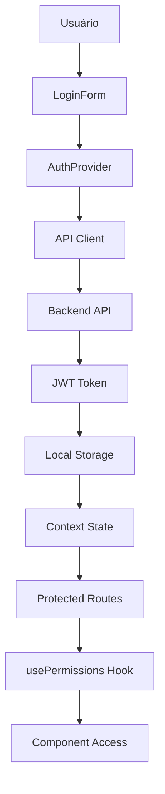
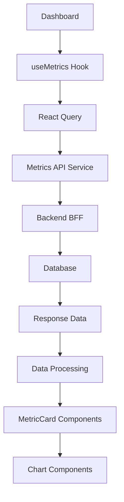
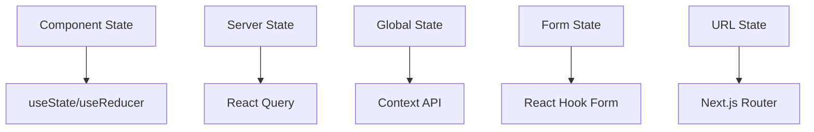

# 🏗️ Arquitetura do Dashboard - Backoffice Veículos

## 📋 Visão Geral

Este documento descreve a arquitetura técnica do dashboard do sistema Backoffice Veículos, incluindo estrutura de componentes, fluxo de dados, padrões de desenvolvimento e decisões arquiteturais.

## 🎯 Objetivos da Arquitetura

- **Escalabilidade**: Suporte a crescimento de funcionalidades e usuários
- **Manutenibilidade**: Código limpo e bem estruturado
- **Performance**: Carregamento rápido e experiência fluida
- **Segurança**: Controle de acesso e proteção de dados
- **Testabilidade**: Componentes testáveis e isolados

## 🏛️ Arquitetura Geral

### Stack Tecnológico

```
Frontend:
├── Next.js 14 (React 18)
├── TypeScript
├── Tailwind CSS
├── React Query (TanStack Query)
├── Recharts (Gráficos)
├── Axios (HTTP Client)
├── React Hook Form
├── Date-fns
└── Lucide React (Ícones)

Backend:
├── Node.js
├── Express.js
├── MongoDB
├── JWT Authentication
└── Railway (Deploy)

Ferramentas:
├── ESLint + Prettier
├── Jest + Testing Library
├── Cypress (E2E)
├── Storybook
└── GitHub Actions (CI/CD)
```

### Estrutura de Pastas

```
src/
├── components/           # Componentes reutilizáveis
│   ├── Auth/            # Autenticação
│   ├── Dashboard/       # Componentes do dashboard
│   ├── Layout/          # Layout e navegação
│   ├── Vehicles/        # Gestão de veículos
│   └── _tests_/         # Testes de componentes
├── hooks/               # Hooks customizados
├── lib/                 # Configurações e utilitários
├── pages/               # Páginas do Next.js
├── services/            # Serviços de API
├── types/               # Definições TypeScript
├── utils/               # Funções utilitárias
└── styles/              # Estilos globais
```

## 🔄 Fluxo de Dados

### 1. Autenticação e Autorização



### 2. Fluxo de Métricas



### 3. Gerenciamento de Estado



## 🧩 Componentes Principais

### 1. AuthProvider
- **Responsabilidade**: Gerenciar estado de autenticação
- **Estado**: Token, usuário, loading, error
- **Métodos**: login, logout, refreshToken

### 2. MetricCard
- **Responsabilidade**: Exibir métricas individuais
- **Props**: title, value, change, icon, loading
- **Estados**: loading, error, success

### 3. SalesChart
- **Responsabilidade**: Renderizar gráficos de vendas
- **Tipos**: line, bar, area
- **Features**: responsivo, tooltips, animações

### 4. DateRangePicker
- **Responsabilidade**: Seleção de períodos
- **Features**: presets, validação, formatação
- **Integração**: useFilters hook

### 5. ErrorBoundary
- **Responsabilidade**: Captura de erros React
- **Features**: fallback UI, error logging, recovery

## 🔐 Sistema de Permissões

### Matriz de Permissões

| Role | Dashboard | Vehicles | Sales | Users | Reports | Settings |
|------|-----------|----------|-------|-------|---------|----------|
| Admin | R/W | R/W/D | R/W/D | R/W/D | R/W | R/W |
| Manager | R/W | R/W/D | R/W/D | R | R/W | R |
| Seller | R | R/W | R/W | - | R | - |
| Viewer | R | R | R | - | R | - |

### Implementação

```typescript
// Hook de permissões
const { hasPermission, hasRole } = usePermissions();

// HOC de proteção
const ProtectedComponent = withPermission(Component, {
  permission: 'dashboard:read'
});

// Verificação inline
if (hasPermission('vehicles:write')) {
  // Renderizar botão de edição
}
```

## 📊 Gerenciamento de Estado

### 1. Server State (React Query)

```typescript
// Cache de métricas
const { data, isLoading, error } = useQuery({
  queryKey: ['metrics', filters],
  queryFn: () => fetchMetrics(filters),
  staleTime: 5 * 60 * 1000, // 5 minutos
  cacheTime: 10 * 60 * 1000  // 10 minutos
});
```

### 2. Client State (Context + Hooks)

```typescript
// Estado de filtros
const { filters, setFilters, resetFilters } = useFilters();

// Estado de autenticação
const { user, token, login, logout } = useAuth();
```

### 3. Form State (React Hook Form)

```typescript
// Formulário de veículo
const { register, handleSubmit, formState } = useForm<VehicleForm>();
```

## 🌐 Integração com APIs

### 1. API Client

```typescript
class ApiClient {
  private baseURL: string;
  private token: string | null;

  // Interceptors para auth e errors
  // Métodos CRUD padronizados
  // Tratamento de erros centralizado
}
```

### 2. Serviços Específicos

```typescript
// Metrics Service
export const metricsService = {
  getRevenue: (filters) => apiClient.get('/metrics/revenue', filters),
  getSalesByDay: (filters) => apiClient.get('/metrics/sales-by-day', filters),
  getTopSellers: (filters) => apiClient.get('/metrics/top-sellers', filters)
};
```

### 3. Hooks de API

```typescript
// Hook customizado para métricas
export const useMetrics = (filters) => {
  return useQuery({
    queryKey: ['metrics', filters],
    queryFn: () => metricsService.getAll(filters),
    enabled: !!filters.startDate && !!filters.endDate
  });
};
```

## 🎨 Sistema de Design

### 1. Design Tokens

```typescript
// Cores
const colors = {
  primary: '#3B82F6',
  secondary: '#10B981',
  error: '#EF4444',
  warning: '#F59E0B',
  success: '#10B981'
};

// Tipografia
const typography = {
  fontFamily: 'Inter, sans-serif',
  sizes: {
    xs: '0.75rem',
    sm: '0.875rem',
    base: '1rem',
    lg: '1.125rem',
    xl: '1.25rem'
  }
};
```

### 2. Componentes Base

```typescript
// Button Component
interface ButtonProps {
  variant: 'primary' | 'secondary' | 'danger';
  size: 'sm' | 'md' | 'lg';
  loading?: boolean;
  disabled?: boolean;
}
```

### 3. Layout System

```typescript
// Grid System
const Grid = {
  container: 'max-w-7xl mx-auto px-4 sm:px-6 lg:px-8',
  row: 'flex flex-wrap -mx-4',
  col: (size: number) => `w-full px-4 md:w-${size}/12`
};
```

## 🚀 Performance

### 1. Otimizações de Renderização

```typescript
// React.memo para componentes puros
const MetricCard = React.memo(({ title, value }) => {
  // Component logic
});

// useMemo para cálculos pesados
const processedData = useMemo(() => {
  return processChartData(rawData);
}, [rawData]);

// useCallback para funções estáveis
const handleFilterChange = useCallback((newFilters) => {
  setFilters(newFilters);
}, []);
```

### 2. Lazy Loading

```typescript
// Lazy loading de componentes
const SalesChart = lazy(() => import('./SalesChart'));

// Lazy loading de páginas
const ReportsPage = lazy(() => import('../pages/reports'));
```

### 3. Code Splitting

```typescript
// Dynamic imports
const HeavyComponent = dynamic(() => import('./HeavyComponent'), {
  loading: () => <Skeleton />,
  ssr: false
});
```

## 🧪 Estratégia de Testes

### 1. Testes Unitários

```typescript
// Component testing
describe('MetricCard', () => {
  it('renders with correct props', () => {
    render(<MetricCard title="Sales" value={1000} />);
    expect(screen.getByText('Sales')).toBeInTheDocument();
  });
});
```

### 2. Testes de Integração

```typescript
// Hook testing
describe('useMetrics', () => {
  it('fetches metrics data', async () => {
    const { result } = renderHook(() => useMetrics(filters));
    await waitFor(() => {
      expect(result.current.data).toBeDefined();
    });
  });
});
```

### 3. Testes E2E

```typescript
// Cypress tests
describe('Dashboard Flow', () => {
  it('should display metrics after login', () => {
    cy.login('admin@backoffice.com', 'password');
    cy.visit('/dashboard');
    cy.get('[data-testid="metric-card"]').should('be.visible');
  });
});
```

## 🔒 Segurança

### 1. Autenticação

- JWT tokens com expiração
- Refresh token automático
- Logout em caso de token inválido

### 2. Autorização

- Verificação de permissões no frontend
- Validação no backend
- Rotas protegidas

### 3. Sanitização

- Validação de inputs
- Escape de dados
- Proteção XSS

## 📱 Responsividade

### 1. Breakpoints

```typescript
const breakpoints = {
  sm: '640px',
  md: '768px',
  lg: '1024px',
  xl: '1280px',
  '2xl': '1536px'
};
```

### 2. Mobile First

- Design mobile-first
- Componentes responsivos
- Touch-friendly interfaces

## 🚀 Deploy e CI/CD

### 1. Pipeline

```yaml
# GitHub Actions
name: Deploy
on:
  push:
    branches: [main]
jobs:
  test:
    runs-on: ubuntu-latest
    steps:
      - uses: actions/checkout@v2
      - name: Run tests
        run: npm test
  deploy:
    needs: test
    runs-on: ubuntu-latest
    steps:
      - name: Deploy to Railway
        run: railway up
```

### 2. Ambientes

- **Development**: Local development
- **Staging**: Railway preview
- **Production**: Railway production

## 📈 Monitoramento

### 1. Error Tracking

- Error boundaries
- Console logging
- Error reporting service

### 2. Performance

- Core Web Vitals
- Bundle analysis
- Performance monitoring

## 🔄 Manutenção

### 1. Atualizações

- Dependências atualizadas regularmente
- Security patches
- Feature updates

### 2. Refatoração

- Code reviews
- Refactoring contínuo
- Technical debt management

## 📚 Documentação

### 1. Código

- JSDoc comments
- TypeScript types
- README files

### 2. Componentes

- Storybook stories
- Usage examples
- API documentation

## 🎯 Próximos Passos

1. **Implementar PWA**
2. **Adicionar internacionalização**
3. **Melhorar acessibilidade**
4. **Implementar cache offline**
5. **Adicionar mais testes**

---

**Última atualização**: Janeiro 2025  
**Versão**: 1.0.0  
**Mantenedor**: Squad Backoffice
